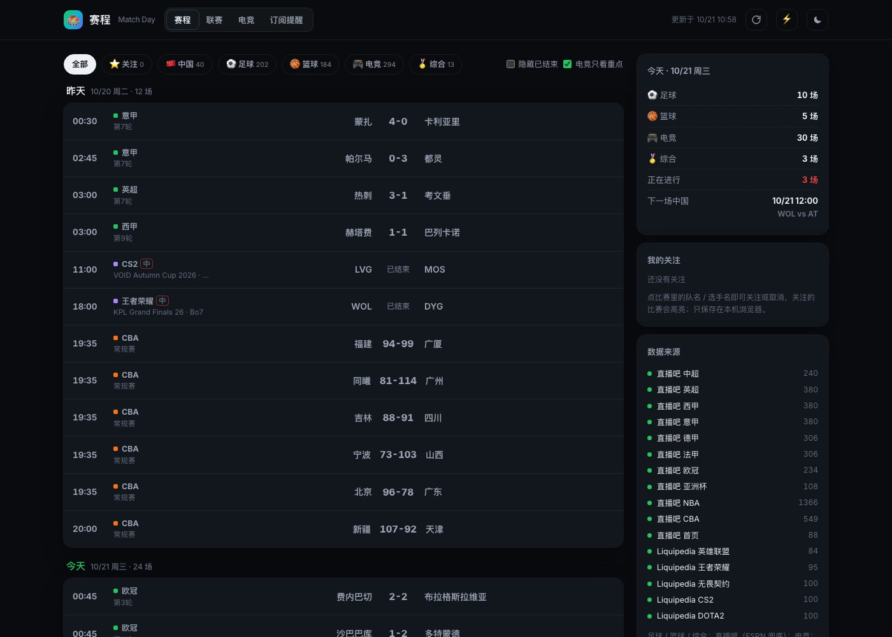
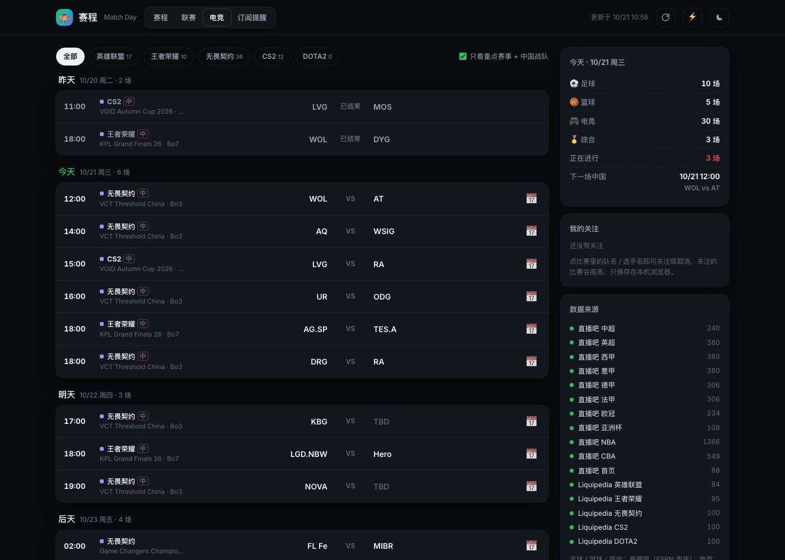

# 🏟️ Match Day · 赛程

> 足球、篮球、综合赛事与电竞的赛程比分：北京时间、转播频道、中国队 / 中国战队一键筛选、可订阅的开赛提醒

**🌐 在线访问：[https://climb0516.github.io/match-day/](https://climb0516.github.io/match-day/)**

---

## 截图

**赛程**：按天排列（昨天 / 今天 / 明天…），比分、转播频道、进行中标记；可按项目、中国、我的关注筛选



**电竞**：英雄联盟 / 王者荣耀 / 无畏契约 / CS2 / DOTA2，默认只看重点赛事 + 中国战队



---

## 功能

- **赛程**（首页，`#feed`）
  - 从昨天开始按天分组，默认 4 天，可「再看 3 天」，最多到未来 14 天
  - 每场：开赛时间、赛事 / 轮次、对阵、比分（已结束）、**转播频道**（CCTV5、咪咕等，来自直播吧）
  - 筛选：全部 / ⭐ 关注 / 🇨🇳 中国 / ⚽ 足球 / 🏀 篮球 / 🎮 电竞 / 🏅 综合；可隐藏已结束、电竞只看重点
  - 「进行中」按开赛时间和项目时长估算，每分钟自动刷新
- **联赛**（`#league`）：中超、英超、西甲、意甲、德甲、法甲、欧冠、亚洲杯、NBA、CBA 的整季赛程，按轮次（篮球按日期）翻页，默认定位到最近一轮
- **电竞**（`#esports`）：5 个项目分标签；「重点」= 世界赛、MSI、LPL、LCK、KPL、VCT、Major、IEM、BLAST、TI 等；带「中」标记的是中国战队 / 中国赛区
- **我的关注**：点比赛里的队名或选手名即可关注，关注的比赛在当天置顶高亮，右侧列出全部关注；只保存在本机浏览器（localStorage）
- **开赛提醒**
  - 单场：点 📅 下载 .ics，开赛前 30 分钟提醒
  - **订阅日历**（`#sub`）：`china.ics`、`football.ics`、`basketball.ics`、`esports.ics`，订阅一次自动同步未来 14 天的比赛
- 右侧挂件：今天各项目场次、正在进行、下一场中国 / 关注的比赛、来源状态
- 右上角：↻ 重新读取数据，⚡ 跳转 GitHub Actions 手动触发抓取，☾ 深浅色；手机适配

### 订阅地址

| 日历 | 地址 |
|---|---|
| 中国（国家队、中国战队） | `https://climb0516.github.io/match-day/china.ics` |
| 足球 | `https://climb0516.github.io/match-day/football.ics` |
| 篮球（NBA、CBA） | `https://climb0516.github.io/match-day/basketball.ics` |
| 电竞重点赛事 | `https://climb0516.github.io/match-day/esports.ics` |

iPhone 可以直接打开 `webcal://` 开头的同一地址订阅；Google 日历用「通过网址添加」。

---

## 数据来源

| 来源 | 内容 | 说明 |
|---|---|---|
| [直播吧](https://www.zhibo8.com/) 数据接口 | 10 个联赛整季赛程、比分（中文队名） | 主数据源 |
| 直播吧 首页 | 未来 2～3 天全部赛事、转播频道，含斯诺克、网球、乒乓球、体操等综合项目 | 联赛比赛补频道；联赛以外的单独列出 |
| [Liquipedia](https://liquipedia.net/) | 5 个电竞项目最近 50 场已结束 + 50 场即将开始 | CC BY-SA 3.0；按其 API 条款每次请求间隔 30 秒、带 gzip 和自定义 UA |
| [ESPN](https://www.espn.com/) | 足球 / NBA 近期赛程比分（英文） | 直播吧某个联赛取不到时兜底 |

**限制**：
- 直播吧可能拦截海外服务器（GitHub Actions），被拦时足球、NBA 改用 ESPN 的英文数据，CBA 和综合项目沿用上一次的数据
- 综合项目只有未来 2～3 天（直播吧首页的范围）；暂无积分榜
- 电竞队名用 Liquipedia 的英文缩写（BLG、AG、TES.A…）；「中国战队」靠赛事名（LPL / KPL / China）和内置战队名单判断，可能有漏判
- 「进行中」是估算值，不是实时比分；比分每 2 小时更新一次

---

## 技术架构

```
GitHub Actions（每 2 小时 / 手动 / 修改爬虫后 push）
  ↓ python scraper.py（只用标准库）
  ↓ 直播吧 10 个联赛 + 首页（频道、综合项目） + Liquipedia 5 个项目（间隔 31 秒） ；失败时 ESPN / 旧数据兜底
  ↓ 合并成统一时间线（过去 3 天 ~ 未来 14 天），标记中国 / 重点赛事
  ↓ 写入 data.json 和 4 个 .ics，commit（updated 每次都变 = 心跳，防止定时任务因 60 天不活跃被停用）
       ↓
GitHub Pages（index.html 读取同目录 data.json，筛选、关注、状态估算都在前端完成）
```

### data.json 结构

```
{
  "updated": "2026-10-21T10:58:00+08:00",
  "events": [                                   // 统一时间线，按开赛时间排序
    { "id": "zb2295806", "ts": 1792582500, "t": "2026-10-21T19:35+08:00", "sport": "basketball",   // football / basketball / esports / other
      "league": "CBA", "stage": "常规赛", "home": "浙江", "away": "山东", "score": "", "status": "pre",  // pre / live / post
      "tv": ["CCTV5", "咪咕"], "china": false, "icon": "🏀" },
    { "id": "lq-valorant-…", "sport": "esports", "game": "无畏契约", "league": "VCT Threshold China - Week 1",
      "stage": "Bo3", "bo": 3, "home": "WOL", "away": "AT", "homeFull": "Wolves Esports", "awayFull": "…",
      "major": true, "china": true, … }
  ],
  "leagues": { "英超": { "sport": "football", "src": "直播吧",
               "groups": [ { "title": "第8轮", "matches": [ { "id": "zb…", "ts": …, "home": "…", "away": "…", "score": "3-1", "fin": true, "stage": "" } ] } ] } },
  "feeds": { "china.ics": { "title": "Match Day · 中国", "count": 27 } },     // 字段只增不减，pages-dashboard 会读
  "sources": [ { "name": "直播吧 英超", "ok": true, "count": 380, "updated": "…" } ]
}
```

---

## 本地预览

```
python3 scraper.py        # 约 2.5 分钟（Liquipedia 限流）
python3 -m http.server 8800
# 打开 http://localhost:8800
```
