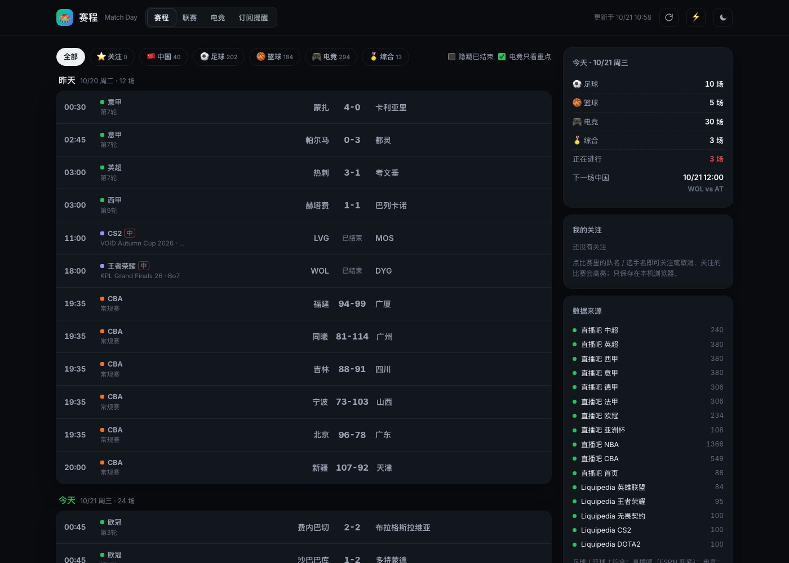
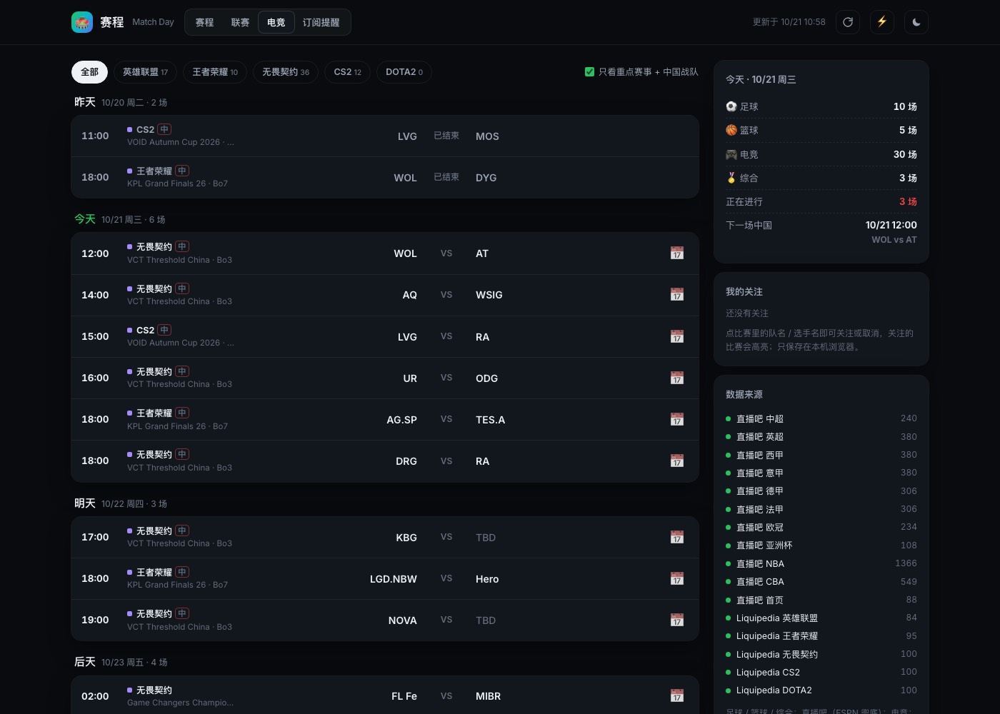

# 🏟️ Match Day · 赛程

> 足球、篮球、综合赛事与电竞的赛程比分：北京时间、转播频道、中国队 / 中国战队一键筛选、可订阅的开赛提醒

**🌐 在线访问：[https://climb0516.github.io/match-day/](https://climb0516.github.io/match-day/)**

---

## 截图

**赛程**：按天排列（昨天 / 今天 / 明天…），比分、转播频道、进行中标记；可按项目、中国、我的关注筛选



**电竞**：英雄联盟 / 王者荣耀 / 无畏契约 / CS2 / DOTA2，默认只看重点赛事 + 中国战队



---

## 功能

- **赛程**（首页，`#feed`）
  - 从昨天开始按天分组，默认 4 天，可「再看 3 天」，最多到未来 14 天
  - 每场：开赛时间、赛事 / 轮次、对阵、比分（已结束）、**转播频道**（CCTV5、咪咕等，来自直播吧）
  - 筛选：全部 / ⭐ 关注 / 🇨🇳 中国 / ⚽ 足球 / 🏀 篮球 / 🎮 电竞 / 🏅 综合；可隐藏已结束、电竞只看重点
  - 「进行中」按开赛时间和项目时长估算，每分钟自动刷新
- **联赛**（`#league`）：中超、英超、西甲、意甲、德甲、法甲、欧冠、亚洲杯、NBA、CBA 的整季赛程，按轮次（篮球按日期）翻页，默认定位到最近一轮
- **电竞**（`#esports`）：5 个项目分标签；「重点」= 世界赛、MSI、LPL、LCK、KPL、VCT、Major、IEM、BLAST、TI 等；带「中」标记的是中国战队 / 中国赛区
- **我的关注**：点比赛里的队名或选手名即可关注，关注的比赛在当天置顶高亮，右侧列出全部关注；只保存在本机浏览器（localStorage）
- **开赛提醒**
  - 单场：点 📅 下载 .ics，开赛前 30 分钟提醒
  - **订阅日历**（`#sub`）：`china.ics`、`football.ics`、`basketball.ics`、`esports.ics`，订阅一次自动同步未来 14 天的比赛
- **队徽**：比赛双方显示队徽 / 战队标志，电竞另带赛事图标（深浅色各有一版的按主题切换）
- 右侧挂件：今天各项目场次、正在进行、下一场中国 / 关注的比赛、来源状态
- 右上角：↻ 重新读取数据，⚡ 跳转 GitHub Actions 手动触发抓取，☾ 深浅色；手机适配

### 订阅地址

| 日历 | 地址 |
|---|---|
| 中国（国家队、中国战队） | `https://climb0516.github.io/match-day/china.ics` |
| 足球 | `https://climb0516.github.io/match-day/football.ics` |
| 篮球（NBA、CBA） | `https://climb0516.github.io/match-day/basketball.ics` |
| 电竞重点赛事 | `https://climb0516.github.io/match-day/esports.ics` |

iPhone 可以直接打开 `webcal://` 开头的同一地址订阅；Google 日历用「通过网址添加」。

---

## 技术架构

```
GitHub Actions（定时每 2 小时 / 手动 dispatch / 修改 scraper.py 或 workflow 后 push）
  ↓ python scraper.py（Python 3.12，只用标准库，无需密钥）
  ↓ ① 直播吧数据接口：10 个联赛整季赛程（失败 → ESPN 兜底 → 再失败沿用上次 data.json）
  ↓ ② 直播吧首页：未来 2～3 天全部赛事 → 给联赛比赛补转播频道，联赛以外的综合项目单独加入
  ↓ ③ Liquipedia 5 个电竞项目（每次请求间隔 31 秒；失败沿用上次该项目的比赛）
  ↓ 队徽 / 赛事图标后台线程下载到 logos/（与限流等待重叠，已有的跳过）
  ↓ 合并为统一时间线（过去 3 天 ~ 未来 14 天），标记中国 / 重点赛事
  ↓ 写入 data.json + china.ics / football.ics / basketball.ics / esports.ics
  ↓ git commit & push（updated 每次都变 = 心跳）
       ↓
GitHub Pages（index.html 读取同目录 data.json?t=时间戳，不走缓存）
  ↓ 前端渲染：赛程时间线 / 联赛 / 电竞 / 订阅，筛选、关注、「进行中」估算都在浏览器里完成
  ↓ 详情抽屉 #/item/match/<id> + 当天列表页 #/list/day/<日期>（kit 组件）
```

---

## 数据来源

| 来源 | 方式 | 每次条数 / 范围 | 备注 |
|---|---|---|---|
| [直播吧](https://www.zhibo8.com/) 数据接口 `dc.qiumibao.com/shuju/public/index.php`（`_url=/data/index`、`tab=赛程`） | 接口（JSON） | 10 个联赛各一次请求，取整季赛程（当前数据：中超 240 场、英超 380 场等，随赛季变化） | 主数据源，中文队名，带比分和队徽 URL；函数 `qmb_league()` |
| 直播吧首页 `www.zhibo8.com` | 网页解析（正则匹配 `<li id="saishi…">`） | 首页上全部赛事，约未来 2～3 天 | 取转播频道（最多 4 个）、比赛页链接、队徽；含斯诺克、网球、乒乓球等综合项目；函数 `zhibo8_home()` |
| [Liquipedia](https://liquipedia.net/) `api.php?action=parse&page=Liquipedia:Matches` | 接口（MediaWiki parse，返回 HTML 再解析） | 5 个项目各一次；页面上的即将开始 + 已结束比赛（代码注释写「即将开始 50 + 最近结束 50」，实际以页面为准） | CC BY-SA 3.0；按其 API 条款每次请求间隔 31 秒、带 gzip 和自定义 UA `MatchDay/1.0`；函数 `liquipedia()` |
| [ESPN](https://www.espn.com/) `site.api.espn.com/apis/site/v2/sports/<路径>/scoreboard?dates=YYYYMMDD` | 接口（JSON） | 仅兜底时使用，逐天请求过去 3 天 ~ 未来 7 天（共 11 次） | 直播吧某联赛失败才用，英文队名；CBA 无 ESPN 路径；函数 `espn_league()` |

**来源配置在哪里 / 如何增删**

- **联赛**：`scraper.py` 里的 `LEAGUES` 列表，每项为（显示名, 项目 football/basketball, 直播吧 type, ESPN 兜底路径或 None）。新增联赛加一行即可，显示名需与直播吧接口的 `league` 参数一致；前端联赛页的列表来自 `data.json` 的 `leagues`，无需改 index.html。
- **电竞项目**：`GAMES` 列表，每项为（Liquipedia wiki 名, 中文名, 重点赛事正则, 中国战队全名集合）。注意每多一个项目运行时间多 31 秒；前端标签顺序写在 index.html 的 `GAMES` 常量。
- **频道过滤词**：`NOT_TV`（直播吧首页链接里不是频道的文字，如「文字」「集锦」「录像」）。
- **综合项目占位词**：`SPORT_WORDS`（首页把项目名填进对阵位置时，用来识别并清空对阵）。

**限制**

- 直播吧可能拦截海外服务器（GitHub Actions），被拦时足球、NBA 改用 ESPN 的英文数据，CBA 和综合项目沿用上一次的数据
- 综合项目只有未来 2～3 天（直播吧首页的范围）；暂无积分榜
- 电竞队名用 Liquipedia 的英文缩写（BLG、AG、TES.A…）；「中国战队」靠赛事名和内置战队名单判断，可能有漏判
- 「进行中」是估算值，不是实时比分；比分每 2 小时更新一次

---

## 数据处理规则

**时间窗口**：`PAST_DAYS, FUTURE_DAYS = 3, 14`，只有开赛时间在「现在 − 3 天 ~ 现在 + 14 天」内的比赛进入时间线 `events`；联赛整季赛程 `leagues` 不受此限制。所有时间按北京时间（`CST = UTC+8`）。

**联赛三级兜底**（`main()` 第 1 步）：`qmb_league()` → 失败用 `espn_league()`（来源记为 `ESPN`）→ 再失败沿用旧 `data.json` 的该联赛（来源记为「直播吧（旧数据）」等）；旧数据也没有则跳过该联赛。

**比分与状态**

- 直播吧：只有 `is_finish` 为真且比分含数字时才写 `score`，否则为空
- `status()`：已结束（`fin`）→ `post`；否则按开赛时间 + 项目时长估算：开赛后时长内为 `live`，未开赛为 `pre`，超时为 `post`
- 时长：足球 2 小时、篮球 2.5 小时、电竞 `(BO 数 或 1) × 0.8 + 0.3` 小时、综合项目 2.5 小时
- 前端 `liveStatus()` 用同样的时长按当前时间重算（有比分即视为已结束），每 60 秒刷新一次，所以数据晚 2 小时也不影响「进行中」标记

**阶段（stage）**：优先用接口里的赛事字段；没有时用分组标题（如「第8轮」），分组标题是日期格式（篮球按日期分组）时留空。电竞 stage 写 `Bo3` 这类赛制。

**直播吧首页合并**（`main()` 第 2 步）

- 匹配：同一北京日期内、两队名集合相同（`{home, away}` 相等）的联赛比赛 → 补 `tv`、`url`，联赛自身缺队徽时用首页的补上
- 未匹配：标签含「电竞」的跳过（电竞以 Liquipedia 为准）；其余作为新比赛加入，`type` 为 football / basketball 的归对应项目，其它都归 `other`（综合），综合项目的 `league` 用首页的第一个标签
- 对阵清洗：主客队同名，或任一方命中 `SPORT_WORDS`（如「环贵州 vs 自行车」）→ 清空对阵和队徽，前端改为单行显示赛事名
- 频道：比赛条目里所有链接文字去掉 `NOT_TV` 中的词，去重后最多保留 4 个

**电竞（Liquipedia）**（`liquipedia()` + `main()` 第 3 步）

- 项目之间 `time.sleep(31)`，第一个项目不等
- 解析每个 `match-info` 块：时间戳、队名缩写 + 全名（去掉「(page does not exist)」）、比分（两边都非空才算）、`(BoN)`、赛事名和赛事页链接（去掉 `#日期` 锚点）；缺队名补 `TBD`
- 去重：同一场会同时出现在「倒计时」和「已结束」两个区，按 `(ts, home, away)` 去重，优先保留带比分的
- 有比分即视为已结束
- 某项目失败：沿用旧数据里该项目、且仍在时间窗口内的比赛
- id：`lq-<wiki>-<时间戳>-<两队名只保留字母数字>`

**中国 / 重点赛事标记**

- 足球 / 篮球 / 综合：`CN_TEXT` 正则（`中国|国足|国奥|国乒|国羽|女足|男篮|女篮`）匹配两队名（首页条目还匹配标签）→ `china: true`
- 电竞 `china`：赛事名匹配 `CN_ESPORTS_LEAGUE`（`\b(LPL|KPL|China|CN)\b`），或任一方全名在该项目的中国战队集合里，或王者荣耀且赛事名含 KPL
- 电竞 `major`：赛事名匹配该项目在 `GAMES` 里的重点正则，例如英雄联盟 `Worlds|MSI|LPL|LCK|LEC|LTA`（排除 AS / CL / Academy 次级联赛）及 Esports World Cup；CS2 `Major|IEM|BLAST|PGL|ESL Pro League|Esports World Cup`

**队徽 / 赛事图标（`Logos` 类）**

- 来源有防盗链（外站引用返回 403），统一下载到仓库 `logos/`，页面同源引用；`Logos.plan()` 按域名决定保存路径和下载地址：

| 图片域名 | 保存到 | 实际下载地址 | 线程池 |
|---|---|---|---|
| `*.duoduocdn.com`（直播吧） | `logos/zb/` | 原地址加 `?x-oss-process=image/resize,w_64`（阿里云 OSS 缩成 64px 宽） | 6 线程 |
| `*.espncdn.com`（ESPN 兜底） | `logos/espn/` | `a.espncdn.com/combiner/i?img=<路径>&h=64&w=64` | 与直播吧共用 6 线程 |
| `liquipedia.net/commons/images/` | `logos/lq/` | 原缩略图地址（约 50px 高），带自定义 UA | 1 线程，每张下载后停 0.3 秒 |

- 文件名：路径非字母数字字符替换为 `_`，保留最后 80 个字符；Liquipedia 去掉 `NNpx-` 前缀，文件名含非 ASCII 字符时改用 `md5` 前 12 位 + 原扩展名
- 去重：同一相对路径已存在或已排队就不再下载，所以每张图只下一次
- 校验：响应 `Content-Type` 不是 `image/*`，或小于 200 字节，视为失败；先写 `.part` 再改名，避免半截文件
- 电竞图标排队顺序（`queue_es_logos()`）：未开始的比赛优先，先队徽、后赛事图标和深色版；下载与下一次 31 秒限流等待重叠
- 收尾：`logos.finish(30)` 最多再等 30 秒，没下完的放弃，下次运行补；写入前用 `Logos.ok()` 过滤掉本地不存在的路径
- 深色版：`lq_imgs()` 按 class 含 `darkmode` 区分深浅两版；深色版与浅色版相同时不写 `*Dark` 字段
- 联赛队徽映射 `leagues[名].logos`（队名 → 路径）：在旧映射基础上更新，所以用旧数据兜底时仍保留上次的队徽
- 当前仓库 `logos/zb/` 345 张、`logos/lq/` 318 张，`logos/espn/` 尚无文件（ESPN 兜底未触发过）

**排序与图标**：`events` 按 `(ts, league)` 排序；`icon` 按项目映射 ⚽ / 🏀 / 🎮 / 🏅。

**订阅日历（`ics()`）**

| 文件 | 内容 |
|---|---|
| `china.ics` | `china` 为真的比赛 |
| `football.ics` | 足球 |
| `basketball.ics` | 篮球 |
| `esports.ics` | 电竞且 `major` 或 `china` |

- 已结束（`status == post`）的不写入；时长同上（电竞为 `BO × 0.8 + 0.2` 小时）
- 每场带 `VALARM`，开赛前 30 分钟提醒（`TRIGGER:-PT30M`）；日历头带 `REFRESH-INTERVAL PT6H`、`X-WR-TIMEZONE:Asia/Shanghai`
- UID 为 `<比赛 id>@match-day`，订阅端据此更新同一场比赛

---

## 数据结构

`data.json`（紧凑 JSON，无缩进）顶层字段：

```
{
  "updated": "2026-10-22T12:49:10+08:00",     // 本次运行时间（北京时间，秒级），每次都变 = 心跳
  "logoBase": "https://climb0516.github.io/match-day/",   // *Logo 都是相对路径，站外使用时拼上这个前缀
  "events": [ … ],                             // 统一时间线（过去 3 天 ~ 未来 14 天），按开赛时间排序
  "leagues": { "英超": { … }, … },             // 10 个联赛整季赛程
  "feeds": { "china.ics": { "title": "Match Day · 中国", "count": 42 }, … },   // 各订阅日历未结束场次；字段只增不减，pages-dashboard 会读
  "sources": [ { "name": "直播吧 英超", "ok": true, "count": 380, "updated": "…" },
               { "name": "Liquipedia CS2", "ok": false, "error": "前 120 字符错误信息", "updated": "上次成功时间" } ]
}
```

`events` 单条（足球 / 篮球 / 综合）：

```
{
  "id": "zb2295806",                 // zb<直播吧赛事 id> / espn<ESPN id>
  "ts": 1792582500,                  // 开赛 Unix 时间戳（秒）
  "t": "2026-10-21T19:35+08:00",     // 北京时间 ISO（分钟精度）
  "sport": "basketball",             // football / basketball / esports / other
  "league": "CBA",                   // 综合项目为首页第一个标签（如「斯诺克」）
  "stage": "常规赛",
  "home": "浙江", "away": "山东",     // 综合项目可能都为空
  "score": "",                       // 已结束才有，如 "3-1"
  "status": "pre",                   // pre / live / post（抓取时估算，前端会重算）
  "tv": ["CCTV5", "咪咕"],            // 最多 4 个
  "url": "https://www.zhibo8.com/zhibo/…htm",   // 可缺省
  "china": false,
  "icon": "🏀",
  "homeLogo": "logos/zb/….png", "awayLogo": "logos/zb/….png"   // 可缺省
}
```

`events` 单条（电竞），在上面基础上多出：

```
{
  "id": "lq-valorant-1792…-WOLAT", "sport": "esports", "game": "无畏契约",
  "league": "VCT Threshold China - Week 1", "stage": "Bo3", "bo": 3,
  "home": "WOL", "away": "AT", "homeFull": "Wolves Esports", "awayFull": "…",
  "major": true, "china": true, "url": "https://liquipedia.net/…（赛事页）",
  "homeLogo": "logos/lq/Wolves_Esports_allmode.png", "awayLogo": "logos/lq/A_Team_lightmode.png",
  "homeLogoDark": "…", "awayLogoDark": "logos/lq/A_Team_darkmode.png",   // 仅当深色版不同时才有
  "leagueLogo": "logos/lq/…_icon_allmode.png", "leagueLogoDark": "…"      // 电竞赛事图标
}
```

`leagues` 单个联赛：

```
"英超": {
  "sport": "football",
  "src": "直播吧",                    // 直播吧 / ESPN / 「…（旧数据）」
  "groups": [ { "title": "第8轮",     // 篮球为日期；ESPN 兜底时为「近期（ESPN）」
                "matches": [ { "id": "zb…", "ts": 1792…, "home": "…", "away": "…", "score": "3-1", "fin": true, "stage": "" } ] } ],
  "logos": { "阿森纳": "logos/zb/zuqiu_zq_asenna_038936.png" }   // 本联赛 队名 → 队徽
}
```

**其他文件**

| 文件 / 目录 | 说明 |
|---|---|
| `china.ics` / `football.ics` / `basketball.ics` / `esports.ics` | 可订阅日历，每次运行重写（规则见上） |
| `logos/zb/`、`logos/lq/`、`logos/espn/` | 队徽 / 赛事图标缓存，随 data.json 一起提交 |
| `screenshot-*.jpg` | README 截图 |

---

## 前端

**详情抽屉 + 列表页（通用 kit 组件，内联在 index.html）**

- 点任意比赛打开详情抽屉：电脑右侧滑出，手机底部升起；地址写成 `#/item/<类型>/<id>`，可直接复制分享，打开分享链接会在数据读完后（`KIT.boot()`）自动弹出；浏览器返回 / Esc / 点遮罩关闭
- 条目已下榜 / 过期（分享链接里的 id 不在当前数据里）时，弹出「这条内容已不在当前数据里」提示，带「回到首页」按钮
- 列表页地址 `#/list/<key>`，带返回按钮；列表页是新开的一层：从右侧滑入盖在首页上，返回时滑走；首页一直在底下不动，滚动位置不变。在列表里点开的详情盖在这一层之上；直接打开列表链接时不播进场动画；安卓手机可从左边缘右滑返回（iOS 用系统自带手势）。

本项目实际注册的类型：

| 类型 | 地址 | 内容 |
|---|---|---|
| 条目 `match` | `#/item/match/<比赛 id>` | 双方队徽 + 比分 / VS + 状态（未开赛显示倒计时）；「比赛信息」键值格（开赛时间、状态、赛事、阶段、赛制、比分、转播）；两队各自「后续 3 场 + 近期 3 场」；同轮其它比赛（最多 12 场）；按钮「📅 加到日历」（未结束时）、「比赛页 ↗ / 赛事页 ↗」。索引 `matchIndex()` 以 `events` 为主，并把联赛整季赛程里其余场次补进来，所以联赛页、近期战绩里的比赛也能点开 |
| 列表 `day` | `#/list/day/YYYY-MM-DD?sport=&lg=` | 某一天的全部比赛：按项目切换（带场次数）、按联赛下拉筛选、前一天 / 后一天、「隐藏已结束」「电竞只看重点」开关，每页 30 场「加载更多」；关注的置顶 |

首页时间线每天每个项目先显示 8 场（`DAY_CAP`），多出的通过「查看当天全部 N 场 →」进入 `day` 列表页。

**项目特有功能**

- 四个视图：`#feed` 赛程、`#league` 联赛、`#esports` 电竞、`#sub` 订阅，可直接用地址打开
- 时间线从昨天开始，默认 4 天，「再看 3 天」每次 +3，直到数据里最后一天
- 全部时间按北京时间显示（与访问者所在时区无关）
- 「我的关注」、当前视图、筛选、主题等都存在浏览器 localStorage（键名前缀 `md.`）
- 队徽：有深色版时输出两张图按主题切换；图片加载失败直接移除，不显示破图
- 单场 📅：前端生成 .ics 下载，开赛前 30 分钟提醒
- ↻ 重新读取 data.json（带时间戳参数、`cache: no-store`）；⚡ 跳转 GitHub Actions 手动触发

---

## 本地运行

```
python3 scraper.py           # 只用标准库，无需 pip 依赖、无需环境变量 / 密钥
python3 -m http.server 8800
# 打开 http://localhost:8800
```

- Python 版本：Actions 用 3.12；本地 3.9+ 即可（代码用到 `cancel_futures`，需 3.9+）
- 耗时：Liquipedia 4 次 31 秒间隔约 2 分钟，加上队徽最多再等 30 秒，整体约 2.5 分钟
- 运行会覆盖 `data.json`、4 个 `.ics`，并往 `logos/` 增加新图片
- 结束时打印各项目场次、各联赛来源、失败来源、队徽下载统计（新增 / 失败 / 未完成）

---

## 自动更新机制

| 触发方式 | 时机 |
|---|---|
| GitHub Actions 定时任务（`cron: '7 */2 * * *'`，UTC） | 每 2 小时一次，北京时间每天 00:07、02:07、04:07 … 22:07（偶数整点后 7 分；GitHub 定时任务高峰期可能延迟） |
| push 到 main 分支 | 仅当修改了 `scraper.py` 或 `.github/workflows/scrape.yml` 时 |
| GitHub Actions 手动 dispatch | 按需触发（页面右上角 ⚡ 直达 Actions 页面） |

- Workflow：`.github/workflows/scrape.yml`（ubuntu-latest + Python 3.12，`concurrency: scrape`，不取消进行中的运行），运行后提交 `data.json *.ics logos`，提交信息 `data: update <北京时间>`，先 `git pull --rebase` 再 push
- **心跳**：`data.json` 的 `updated` 字段每次运行都会变，所以每次都有提交，仓库保持活跃
- GitHub 规定公开仓库 60 天无提交会自动停用定时任务；本项目靠上面的心跳避免。若因 Actions 长期失败等原因被停用，需在仓库 Actions 页面手动重新启用
